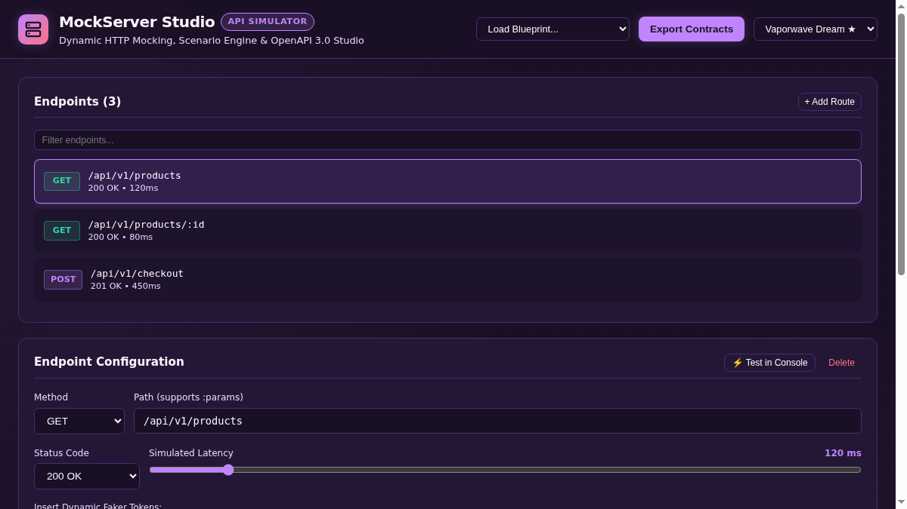

# MockServer Studio — Dynamic HTTP API Mocking & Contract Studio

> Day 11 of the 30-Day Dev Tool Challenge. An in-browser HTTP API mocking and simulation workbench with dynamic templates, latency simulation, MSW handlers, and OpenAPI 3.0 export.



## ✨ Features
- **Dynamic In-Browser HTTP Router**: Route GET, POST, PUT, PATCH, and DELETE requests with parameterized routes (`/api/v1/users/:id`).
- **Dynamic Faker Templating**: Replaces `{{faker.name}}`, `{{faker.email}}`, `{{faker.uuid}}`, `{{faker.date}}`, and `{{param.id}}` with realistic synthetic data.
- **Latency Simulator**: Dial in network delays between 0ms and 1200ms to test loading states and UI spinners.
- **Interactive Live Tester**: Test endpoints directly from the browser console with round-trip latency measurements and formatted status badges.
- **Contract Exporters**:
  - **OpenAPI 3.0.0**: Standardized JSON OpenAPI specification.
  - **MSW 2.0**: Drop-in Mock Service Worker handlers.
  - **Express.js Router**: Backend mock router code.
- **Vaporwave Dream Theme**: Pastel lavender (`#c084fc`) and neon coral (`#fb7185`) over deep mauve (`#1a1026`).
- **Modular React 19 Architecture**: Decomposed into clean components in `src/components/`.

## 🛠️ Quick Start

### 1. Install & Run Locally
```bash
cd day-11-mockserver
npm run dev
```

### 2. Run Automated Tests
```bash
npm test
```
All 9 unit tests run through Node's native test runner (`node --test tests/*.test.js`).

### 3. Build for Production
```bash
npm run build
```
Generates a minified, tree-shaken static bundle in `dist/` in ~240ms with Vite.

## 📁 Project Structure
```
day-11-mockserver/
├── index.html
├── package.json
├── vite.config.js
├── firebase.json
├── .firebaserc
├── src/
│   ├── main.jsx
│   ├── App.jsx
│   ├── mockEngine.js
│   ├── sampleCollections.js
│   ├── themes.js
│   ├── style.css
│   └── components/
│       ├── Header.jsx
│       ├── RouteListSidebar.jsx
│       ├── RouteEditorPanel.jsx
│       ├── InteractiveTesterPanel.jsx
│       ├── ContractExportModal.jsx
│       └── Toast.jsx
├── tests/
│   └── mockEngine.test.js
└── linkedin/
    ├── POST.md
    └── snapshots/
        ├── 01_hero_overview.png
        ├── 02_core_workflow.png
        ├── 03_feature_deepdive.png
        └── 04_export_results.png
```

## 📜 License
MIT © sgowdavivek <sgowdavivek@gmail.com>
